# Master Summary of Errors & Corrections Across All 6 Agent Memory Benchmarks

> **Language**: **English** | [简体中文](./ALL_FIXES_SUMMARY_ZH.md)  
> **Main Documentation**: [`README.md`](./README.md)

This master ledger consolidates all data-level corruptions, semantic ground-truth defects, and evaluation/baseline code bugs uncovered and repaired across **6 widely adopted Agent Memory Benchmarks** (**LoCoMo & LoCoMo_refined**, **BEAM**, **LongMemEval**, **MemoryAgentBench**, **MemBench**, and **PerLTQA**).

Every benchmark subdirectory follows a strict **1:1 mirrored layout** (`146` original ↔ fixed file pairs total):
* `original/` — Unmodified upstream dataset files and evaluation/loader source code.
* `fixed/` — Drop-in corrected dataset files and patched source code with identical relative paths and filenames.
* `FIX_SUMMARY.md` ([`FIX_SUMMARY_ZH.md`]) — Detailed file-by-file defect breakdown and repair statistics.

---

## 1. Benchmark Index & Aggregate Repair Matrix

| Benchmark | Subdirectory | Original Files | Corrected Files | Detailed Ledger | Core Fixes Applied (Data + Code) |
| :--- | :--- | :--- | :--- | :--- | :--- |
| **1. LoCoMo & LoCoMo_refined** | [`locomo/`](./locomo/) | [`locomo/original/`](./locomo/original/) | [`locomo/fixed/`](./locomo/fixed/) | [`locomo/FIX_SUMMARY.md`](./locomo/FIX_SUMMARY.md) | Fixed **13** swapped-speaker QAs in `locomo10` (**10** survived undetected in `LoCoMo_refined`), **3** weekday/date typos, **8** shifted/incomplete evidence turn pointers, **16** malformed/dangling pointers, Cat-5 answer leakage, `int` answers, plus **4** `evaluation.py` bugs (bag-of-words EM, `"and"` stripping, `rouge-1` returned as `rouge-l`, asymmetric F1) & `llm_judge.py` rule contradictions |
| **2. BEAM** | [`beam/`](./beam/) | [`beam/original/`](./beam/original/) | [`beam/fixed/`](./beam/fixed/) | [`beam/FIX_SUMMARY.md`](./beam/FIX_SUMMARY.md) | Audited all 100 `probing_questions.json` suites (**30** conversation files / **34** QAs repaired): fixed **2** cross-conversation `"Cypress tests"` rubric contaminations, **3** phantom/anchor-hallucinated QAs + **1** meta-leakage, **11** `answer`-vs-`rubric` contradictions, **3** skipped-month calendar bugs, **5** systematic 2024 leap-year (`Feb 29`) undercounts, **10** `event_ordering` count mismatches, plus Judge missing `<question>` & cross-question list-aliasing contamination |
| **3. LongMemEval** | [`longmemeval/`](./longmemeval/) | [`longmemeval/original/`](./longmemeval/original/) | [`longmemeval/fixed/`](./longmemeval/fixed/) | [`longmemeval/FIX_SUMMARY.md`](./longmemeval/FIX_SUMMARY.md) | Disambiguated **13** duplicate `session_id` collisions in `s_cleaned`, chronologically sorted **211** (`s_cleaned`) / **34** (`oracle`) out-of-order session histories, fixed **76** (`s_cleaned`) / **43** (`oracle`) causal timestamp inversions (`question_date < max(haystack_dates)`), normalized **32** `int` answers each, tightened `evaluate_qa.py`, and removed hardcoded model assertion in `print_qa_metrics.py` |
| **4. MemoryAgentBench** | [`memoryagentbench/`](./memoryagentbench/) | [`memoryagentbench/original/`](./memoryagentbench/original/) | [`memoryagentbench/fixed/`](./memoryagentbench/fixed/) | [`memoryagentbench/FIX_SUMMARY.md`](./memoryagentbench/FIX_SUMMARY.md) | Fixed **7** inverted `Conflict_Resolution` gold answers (labeled older fact instead of newest) & **2,238** template typos (`univeristy`/`origianl`), removed exact duplicate row in `Long_Range_Understanding`, purged train-test leaks & **5,920** duplicate/leaked ICL blocks in `Test_Time_Learning`, normalized `Accurate_Retrieval` nulls, and fixed word-boundary substring bug, inverted slice `encoded[127000:]`, & truncation bypass |
| **5. MemBench** | [`membench/`](./membench/) | [`membench/original/`](./membench/original/) | [`membench/fixed/`](./membench/fixed/) | [`membench/FIX_SUMMARY.md`](./membench/FIX_SUMMARY.md) | Repaired all 19 JSON subsets (26,637 QAs): fixed **3,047** broken template-grammar answer/choice strings (`"eight of week"` → `"eight weeks"`, `"three day"` → `"three days"`), disambiguated **777** MCQs (**787** colliding option slots), serialized **7,460** `list`-typed options, cleaned **65** `None` messages, and fixed Python 2 `raise "..."` crashes |
| **6. PerLTQA** | [`perltqa/`](./perltqa/) | [`perltqa/original/`](./perltqa/original/) | [`perltqa/fixed/`](./perltqa/fixed/) | [`perltqa/FIX_SUMMARY.md`](./perltqa/FIX_SUMMARY.md) | Parsed **25** stringified `social_relationship` dicts in `perltmem_en_v2`, aligned literal machine-translated name `'dragon beautiful'` → `'Long Meili'` (**265** refs), deserialized **8,236** stringified `Reference Memory` fields, recomputed **11,487** English character-span `Memory Anchors`, removed **3** unanswerable missing-entity QAs, and fixed Chinese-key hardcoding in `dataset.py`, `torch.no_grad()` training freeze in `modeling.py`, & uncalled `torch.cuda.is_available` in `encoder_corpus.py` |

---

## 2. Cross-Benchmark Taxonomy of Systematic Failure Modes

```mermaid
flowchart TD
    Root["Systematic Defects Across 6 Agent Memory Benchmarks"]
    Root --> C1["1. Ground-Truth Attribution & Polarity Inversion"]
    Root --> C2["2. Rubric Contamination & Phantom QA Synthesis"]
    Root --> C3["3. Calendar, Arithmetic & Leap-Year Blindness"]
    Root --> C4["4. Temporal & Causal Violations"]
    Root --> C5["5. Evaluator Flaws & Schema/Option Degeneracy"]

    C1 --> C1a["LoCoMo / Refined: 13 / 10 Swapped-Speaker QAs"]
    C1 --> C1b["MemoryAgentBench: 7 Outdated Facts Marked as Gold"]
    C1 --> C1c["PerLTQA: 'dragon beautiful' vs 'Long Meili' (265 refs)"]

    C2 --> C2a["BEAM: Math QAs Graded Against 'Cypress Tests 92%' Rubric"]
    C2 --> C2b["BEAM: Phantom Hotel/Kickoff QAs & '1,18' -> '18 days'"]
    C2 --> C2c["MemoryAgentBench: 15 Verbatim Train-Test Leaks in ICL"]

    C3 --> C3a["BEAM: All 5 Cross-Feb-2024 QAs Miss Leap Day Feb 29"]
    C3 --> C3b["BEAM: 11 Answer/Calc vs Rubric Conflicts & Skipped Months"]
    C3 --> C3c["LoCoMo: 'last Saturday/Tuesday' -> 'Sunday/Thursday'"]

    C4 --> C4a["LongMemEval: 42.2% Unsorted Multi-Session Histories"]
    C4 --> C4b["LongMemEval: 15.2% Queries Timestamped Before Evidence"]

    C5 --> C5a["BEAM Judge Drops <question>; LoCoMo Bag-of-Words EM & Rouge-1"]
    C5 --> C5b["MAB: 'no' in 'i do not know' & encoded[127000:] Tail Slice"]
    C5 --> C5c["MemBench: 777 Duplicate-Choice MCQs & 3,047 Grammar Corruptions"]
```

