# 所有 Agent Memory Benchmark 错误与纠正汇总（总览）

> **语言切换**: [English](./ALL_FIXES_SUMMARY.md) | **简体中文**  
> **项目主文档**: [`README_ZH.md`](./README_ZH.md)

本文档汇总了本仓库对当下最常用的 **6 个 Agent Memory 评测基准**（**LoCoMo & LoCoMo_refined**、**BEAM**、**LongMemEval**、**MemoryAgentBench**、**MemBench**、**PerLTQA**）进行多轮结构校验、源码逐行审查与深度语义 Ground-Truth 审计后的全部错误与修复结果。

每个子文件夹均严格遵循统一的 **1:1 镜像目录规范**（共 **146 对**原版/修正版文件）：
* `original/`：未修改的原始数据集与原始评测/加载代码（同名文件与 `fixed/` 一一对应，可直接 `diff` 对比）
* `fixed/`：修复全部已发现数据错误、标准答案缺陷与评测代码 Bug 后的可直接替换版本
* `FIX_SUMMARY_ZH.md`（英文版 `FIX_SUMMARY.md`）：该数据集的逐文件错误定位与纠正明细

---

## 一、六大数据集索引与修复规模总表

| 数据集 | 子目录 | 原文件目录 | 修正后目录 | 详细汇总文档 | 核心修复概览 |
| :--- | :--- | :--- | :--- | :--- | :--- |
| **1. LoCoMo & LoCoMo_refined** | [`locomo/`](./locomo/) | [`locomo/original/`](./locomo/original/) | [`locomo/fixed/`](./locomo/fixed/) | [`locomo/FIX_SUMMARY_ZH.md`](./locomo/FIX_SUMMARY_ZH.md) | 修复原版 **13 道**（`LoCoMo_refined` 漏检残留 **10 道**）说话人张冠李戴题、**3 道**星期错算/笔误、**8 处**证据轮次偏移、**16 处**损坏证据语法、Cat 5 字段泄漏，以及 `evaluation.py` 词袋 EM / `rouge-1` 冒充 `rouge-l` 等 4 项评测 Bug 与 `llm_judge.py` 规则冲突 |
| **2. BEAM** | [`beam/`](./beam/) | [`beam/original/`](./beam/original/) | [`beam/fixed/`](./beam/fixed/) | [`beam/FIX_SUMMARY_ZH.md`](./beam/FIX_SUMMARY_ZH.md) | 覆盖 `100K`/`500K`/`1M`/`10M` 全量 100 组 `probing_questions.json`（修正 **67 个会话文件、115 道缺陷题**）：替换 **16 道**在 `chat.json` 中漏注入的矛盾/更新题（`7 CR + 9 KU`）并对齐 **1 道**部分漏更题、修复 **65 道**损坏/缺失的 `source_chat_ids` Golden Evidence 证据指针（`27 CR + 23 KU + 12 SUM + 2 PF + 1 EO`）、修复 **2 道**跨会话 `"Cypress tests"` Rubric 粘贴污染、**3 道**凭空捏造或把大纲编号当天数的幻觉题、**11 道**答案与 Rubric 数值自相矛盾、**3 道**跳月/月份天数错算、**5 道** 2024 闰年 2 月 29 日系统性漏算、**8 道**事件排序计数错位，以及 Judge 漏传 `<question>` 与跨题上下文污染 |
| **3. LongMemEval** | [`longmemeval/`](./longmemeval/) | [`longmemeval/original/`](./longmemeval/original/) | [`longmemeval/fixed/`](./longmemeval/fixed/) | [`longmemeval/FIX_SUMMARY_ZH.md`](./longmemeval/FIX_SUMMARY_ZH.md) | 修复 `s_cleaned` **13 处**重复 `session_id`、**211 题**（`oracle` **34 题**）会话时间乱序、**76 题**（`oracle` **43 题**）`question_date` 早于历史证据的因果倒挂、各 **32 题**非字符串答案，以及 `evaluate_qa.py` 过度宽容判分与 `print_qa_metrics.py` 硬编码模型断言 |
| **4. MemoryAgentBench** | [`memoryagentbench/`](./memoryagentbench/) | [`memoryagentbench/original/`](./memoryagentbench/original/) | [`memoryagentbench/fixed/`](./memoryagentbench/fixed/) | [`memoryagentbench/FIX_SUMMARY_ZH.md`](./memoryagentbench/FIX_SUMMARY_ZH.md) | 修复 `Conflict_Resolution` **7 道**新旧冲突标准答案写反题与 2,238 处模板拼写错误、剔除 `Long_Range_Understanding` 完全重复样本行、清除 `Test_Time_Learning` 测试集泄漏与 **5,920 个**重复/泄漏演示块、规范化 `Accurate_Retrieval` 空值，并修复无词边界子串假阳性、`encoded[127000:]` 切片写反与截断绕过 Bug |
| **5. MemBench** | [`membench/`](./membench/) | [`membench/original/`](./membench/original/) | [`membench/fixed/`](./membench/fixed/) | [`membench/FIX_SUMMARY_ZH.md`](./membench/FIX_SUMMARY_ZH.md) | 覆盖全部 19 个 JSON 子集（26,637 题）：修复 **3,047 处**模板拼接病句答案/选项（如 `"eight of week"`→`"eight weeks"`）、消歧 **777 道题（787 槽位）**的重复多选选项、规范化 **7,460 个**列表型选项与 **65 条** `None` 消息，修复 Python 2 `raise "..."` 语法崩溃 |
| **6. PerLTQA** | [`perltqa/`](./perltqa/) | [`perltqa/original/`](./perltqa/original/) | [`perltqa/fixed/`](./perltqa/fixed/) | [`perltqa/FIX_SUMMARY_ZH.md`](./perltqa/FIX_SUMMARY_ZH.md) | 修复 `perltmem_en_v2` **25 名**角色字符串化社会关系、对齐机翻错位主角名 `'dragon beautiful'`→`'Long Meili'`（**265 处**）、反序列化 **8,236 道**题 `Reference Memory`、重算恢复 **11,487 个**英文字符级 `Memory Anchors`、剔除 **3 道**背景缺失不可答题，并修复 `dataset.py` 硬编码中文键、`modeling.py` `torch.no_grad()` 锁死训练梯度及 `encoder_corpus.py` 漏括号崩溃 |

---

## 二、横向共性缺陷分类图谱

```mermaid
flowchart TD
    Root["六大 Agent Memory 基准共性缺陷谱系"]
    Root --> C1["1. 标准答案归属错位与新旧颠倒"]
    Root --> C2["2. 跨样本 Rubric 污染与凭空幻觉题"]
    Root --> C3["3. 日历算术与闰年边界系统性失真"]
    Root --> C4["4. 时序乱序与因果时间戳倒挂"]
    Root --> C5["5. 评测指标失真与多选/跨语言退化"]

    C1 --> C1a["LoCoMo / Refined: 13 / 10 道说话人张冠李戴"]
    C1 --> C1b["MemoryAgentBench: 7 道冲突题把旧事实标为标准答案"]
    C1 --> C1c["PerLTQA: 'dragon beautiful' 机翻导致 265 处失联"]

    C2 --> C2a["BEAM: 数学题粘贴 'Cypress 测试 92%' 评分标准"]
    C2 --> C2b["BEAM: 凭空问订酒店 & 把大纲编号 1,18 当成 18 天"]
    C2 --> C2c["MemoryAgentBench: 测试集原题在演示上下文中泄漏 15 次"]

    C3 --> C3a["BEAM: 全部 5 道跨 2024 年 2 月题漏算闰年 2 月 29 日"]
    C3 --> C3b["BEAM: 11 道答案与 Rubric 自相矛盾 & 跳月少算 30 天"]
    C3 --> C3c["LoCoMo: 原文 Saturday/Tuesday 标成 Sunday/Thursday"]

    C4 --> C4a["LongMemEval: 42.2% 长程历史会话未按时间排序"]
    C4 --> C4b["LongMemEval: 15.2% 提问时间早于历史对话发生时间"]

    C5 --> C5a["BEAM 裁判漏传 <question>；LoCoMo 词袋 EM 与 Rouge-1 错位"]
    C5 --> C5b["MAB: 'no' in 'i do not know' 判对 & encoded[127000:] 切反"]
    C5 --> C5c["MemBench: 777 道重复选项题 & 3,047 处模板拼接病句"]
```

