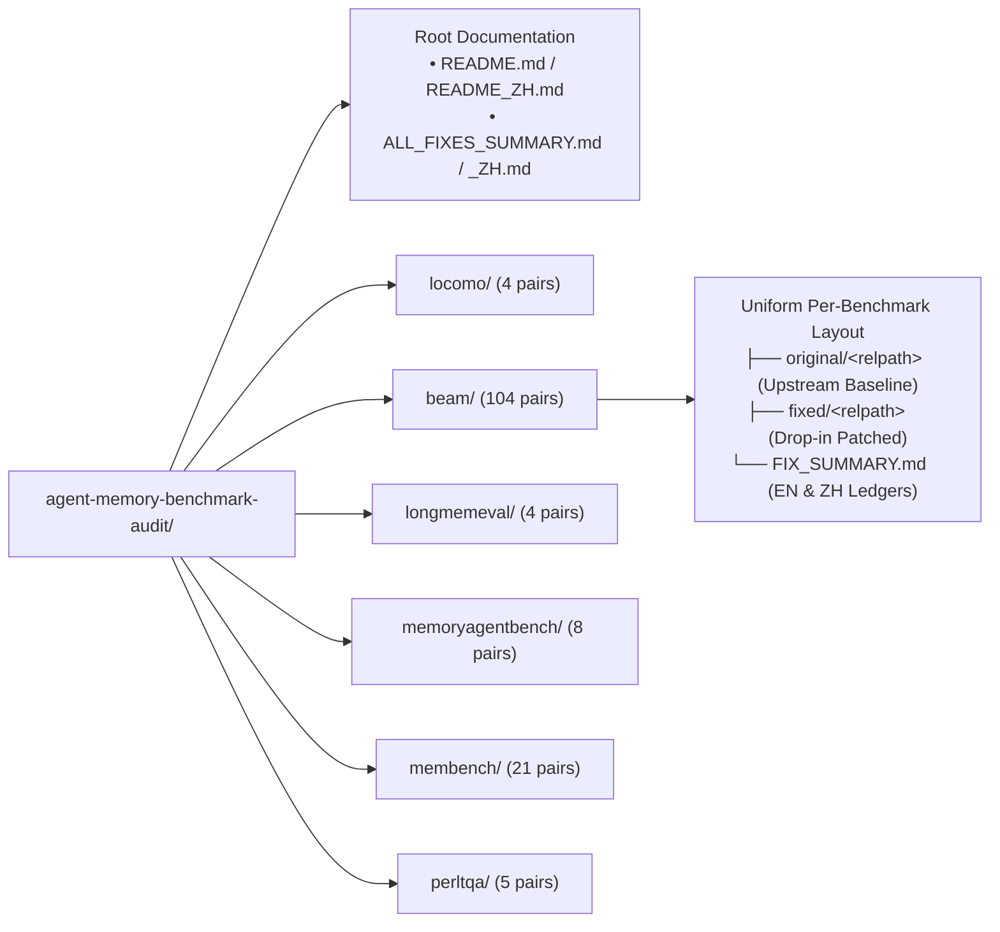
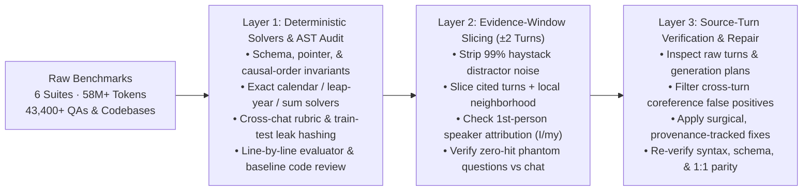
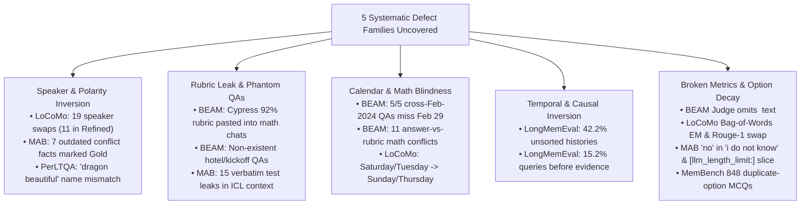

<div align="center">

# Agent Memory Benchmark Audit & Corrected Suite

**Systematic Multi-Round Structural, Code, and Semantic Ground-Truth Audit of 6 Mainstream Agent Memory Benchmarks**

[](#4-benchmark-evaluation-biases--repair-matrix)
[](#2-repository-architecture--11-mirror-design)
[](#1-at-a-glance-audit-dashboard)
[](#3-audit-methodology-3-layer-hybrid-funnel)
[](#6-quick-start--diff-verification)

[-1f2937?style=flat-square)](./README.md)
[](./README_ZH.md)
[](./ALL_FIXES_SUMMARY.md)

[**Overview**](#1-at-a-glance-audit-dashboard) · [**Architecture**](#2-repository-architecture--11-mirror-design) · [**Methodology**](#3-audit-methodology-3-layer-hybrid-funnel) · [**Benchmark Matrix**](#4-benchmark-evaluation-biases--repair-matrix) · [**Case Studies**](#5-smoking-gun-before--after-case-studies) · [**Quick Start**](#6-quick-start--diff-verification)

</div>

---

> [!IMPORTANT]
> **Why This Repository Exists**: Current evaluations of LLM Agent Memory systems (RAG, Graph Memory, Episodic/Semantic Memory, Long-Context Agents) suffer from pervasive **silent evaluation distortion** caused by synthetic ground-truth hallucinations, cross-conversation rubric leaks, leap-year/calendar arithmetic blindness, causal timestamp inversions, and buggy official scoring scripts.  
> This repository provides **exact 1:1 mirrored `original/` and `fixed/` suites** plus **file-by-file defect ledgers** across **LoCoMo (`+ LoCoMo_refined`)**, **BEAM**, **LongMemEval**, **MemoryAgentBench**, **MemBench**, and **PerLTQA**.

---

## 1. At-a-Glance Audit Dashboard

| Benchmark | Audited Corpus Scale | Mirrored File Pairs | Data / Ground-Truth Fixes | Evaluator / Code Fixes | File-by-File Ledger |
| :--- | :--- | :---: | :--- | :--- | :---: |
| **[LoCoMo & LoCoMo_refined](./locomo/)** | 20 dialogues · 3,368 QAs (`1,986` + `1,382`) | `4` | **30** swapped-speaker QAs (`19` raw + `11` leaked into `Refined`), **10** date/duration/polarity/typo answer fixes (`7` raw + `3` refined), **79** `evidence`-repaired QAs (**65** shifted/incomplete/empty + **14** malformed/dangling) | **4** `evaluation.py` metric bugs + **1** contradictory `llm_judge.py` prompt | [EN](./locomo/FIX_SUMMARY.md) \| [中文](./locomo/FIX_SUMMARY_ZH.md) |
| **[BEAM](./beam/)** | 100 chats (`100K`–`10M`, ~58M tokens) · 2,000 QAs | `104` | **67** chat suites (**115** QAs): **16** uninjected `CR`/`KU` QAs (+**1** synced), **65** broken `source_chat_ids` Golden Evidence pointers, **2** Cypress rubric leaks, **4** phantom QAs, **11** answer–rubric conflicts, **3** skipped-month & **5** `Feb 29` bugs, **8** ordering counts | Judge missing `<question>` across **10** evaluators, **2,000x** redundant model reload, list-aliasing context leak | [EN](./beam/FIX_SUMMARY.md) \| [中文](./beam/FIX_SUMMARY_ZH.md) |
| **[LongMemEval](./longmemeval/)** | `Oracle` (500) + `S_cleaned` (500, ~115K tok/item) | `4` | **62** contaminated `answer_session_ids` lists per subset (`32` answerable + `30` `_abs`), **13** duplicate `session_id`s, **245** unsorted histories (`211` `S` + `34` `Oracle`), **119** causal timestamp inversions (`76` `S` + `43` `Oracle`), **64** `int` answers | Over-permissive `±1` temporal judge, stale-fact acceptance, `'yes'` substring bug, hardcoded model `assert` | [EN](./longmemeval/FIX_SUMMARY.md) \| [中文](./longmemeval/FIX_SUMMARY_ZH.md) |
| **[MemoryAgentBench](./memoryagentbench/)** | 4 capability splits · 146 long contexts · 3,671 QAs | `8` | **7** inverted conflict gold answers, **2,238** template typos, **1** duplicate book row, **5,920** leaked/duplicate ICL blocks (**15** verbatim train-test leaks), **17** null ID rows | Word-boundary substring false positive (`"no"` in `"i do not know"`), inverted `encoded[llm_length_limit:]` (`127000`) slice, `longmem_qa_evaluate.py`, truncation bypass | [EN](./memoryagentbench/FIX_SUMMARY.md) \| [中文](./memoryagentbench/FIX_SUMMARY_ZH.md) |
| **[MemBench](./membench/)** | 19 subsets (`FirstAgent` + `ThirdAgent`) · 26,637 QAs | `21` | **47** broken `target_step_id` Golden Evidence pointers (`43` boundary `+1` + `4` empty), **3,127** broken-grammar gold/choice strings (`"eight of week"`), **848** duplicate-choice MCQs (**859** slots), **7,460** `list` options, **65** `None` messages | **2** Python 2 `raise "..."` string-exception crashes in core agent/memory classes | [EN](./membench/FIX_SUMMARY.md) \| [中文](./membench/FIX_SUMMARY_ZH.md) |
| **[PerLTQA](./perltqa/)** | 141 character memories · 8,593 English QAs | `5` | **25** stringified dicts + **2** restored dropped memories (`8_2`, `25_0_2` fixing **11** dangling QAs), `'dragon beautiful'` → `'Long Meili'` (**265** non-profile refs + **28** anchors + **8** Q/As), **8,236** stringified `Reference Memory` lists, **11,613** recomputed English spans, **3** unanswerable QAs removed | Dict-root & Chinese-key crash in `dataset.py`, `torch.no_grad()` freezing training loss in `modeling.py`, uncalled `is_available` | [EN](./perltqa/FIX_SUMMARY.md) \| [中文](./perltqa/FIX_SUMMARY_ZH.md) |

---

## 2. Repository Architecture & 1:1 Mirror Design

The repository contains **zero temporary processing scripts** and organizes all 6 benchmarks under a uniform **1:1 path-mirrored architecture**:



<details>
<summary><b>Click to expand the complete directory tree</b></summary>

```text
agent-memory-benchmark-audit/
├── README.md                                   # Default English documentation
├── README_ZH.md                                # Chinese documentation (简体中文说明)
├── ALL_FIXES_SUMMARY.md                        # Master cross-benchmark fix ledger (English)
├── ALL_FIXES_SUMMARY_ZH.md                     # Master cross-benchmark fix ledger (简体中文)
│
├── locomo/
│   ├── FIX_SUMMARY.md / FIX_SUMMARY_ZH.md
│   ├── original/                               # locomo10.json, locomo_refined.json, evaluation.py, llm_judge.py
│   └── fixed/                                  # Exact 1:1 corrected counterparts
│
├── beam/
│   ├── FIX_SUMMARY.md / FIX_SUMMARY_ZH.md
│   ├── original/                               # probing_questions/{100K,500K,1M,10M}/* (100 files) + 4 .py files
│   └── fixed/                                  # Complete 100-chat drop-in probing_questions/ (67 repaired) + 4 .py files
│
├── longmemeval/
│   ├── FIX_SUMMARY.md / FIX_SUMMARY_ZH.md
│   ├── original/                               # longmemeval_oracle.json, longmemeval_s_cleaned.json.gz, evaluate_qa.py, print_qa_metrics.py
│   └── fixed/                                  # Exact 1:1 corrected counterparts
│
├── memoryagentbench/
│   ├── FIX_SUMMARY.md / FIX_SUMMARY_ZH.md
│   ├── original/                               # 4 .parquet splits + eval_other_utils.py, longmem_qa_evaluate.py, graph_rag.py, agent.py
│   └── fixed/                                  # Exact 1:1 corrected counterparts
│
├── membench/
│   ├── FIX_SUMMARY.md / FIX_SUMMARY_ZH.md
│   ├── original/                               # FirstAgent/*.json (11), ThirdAgent/*.json (8), MembenchAgent.py, CommonMemory.py
│   └── fixed/                                  # Exact 1:1 corrected counterparts
│
└── perltqa/
    ├── FIX_SUMMARY.md / FIX_SUMMARY_ZH.md
    ├── original/                               # perltmem_en_v2.json, perltqa_en_v2.json, dataset.py, modeling.py, encoder_corpus.py
    └── fixed/                                  # Exact 1:1 corrected counterparts
```

</details>

---

## 3. Audit Methodology: 3-Layer Hybrid Funnel

Reading 58M+ tokens of multi-session chat haystacks end-to-end suffers from severe context dilution (*Lost-in-the-Middle*), whereas purely structural schema scripts miss semantic speaker swaps and arithmetic errors. We combine three complementary layers to achieve near-exhaustive recall with **zero unverified edits**:



---

## 4. Benchmark Evaluation Biases & Repair Matrix

Each benchmark exhibits distinct architectural biases alongside specific implementation bugs that systematically favor or penalize particular memory designs:



| Benchmark | Primary Evaluation Bias | Key Structural & Code Flaws Fixed | Key Ground-Truth Semantic Flaws Fixed |
| :--- | :--- | :--- | :--- |
| **LoCoMo & LoCoMo_refined** | Short factoid recall over 2-speaker social chats; `evaluation.py` heavily rewards short keyword overlap while penalizing natural phrasing | Bag-of-words `set` EM; stripping `"and"`; `rougel_score` returning `rouge-1`; non-penalizing multi-hop F1; contradictory extra-detail rules in `llm_judge.py` | **19** QAs in `locomo10` (**11** still in `LoCoMo_refined`) ask about Speaker B when Speaker A said it about themselves; **10** date/duration/polarity/typo answer bugs (`7` + `3`); **79** `evidence`-repaired QAs (**65** shifted/missing + **14** malformed/dangling) |
| **BEAM** | 100% reliant on rubric-based LLM-as-a-Judge (`ideal_answer` is never read during scoring!) | `unified_llm_judge_base_prompt` omitted `<question>` across all 10 evaluators; `messages = saved_messages` list aliasing contaminated Q2–Q20; 2,000x model reloads | **16** uninjected `CR`/`KU` QAs missing from `chat.json` (+**1** synced); **65** broken/missing `source_chat_ids` pointers (`27 CR + 23 KU + 12 SUM + 2 PF + 1 EO`); **2** `"Cypress tests ... 92%"` rubric leaks; **3** phantom QAs; **11** `answer`-vs-`rubric` conflicts; **5** leap-year (`Feb 29`) & **3** skipped-month bugs |
| **LongMemEval** | Needle-in-a-haystack user session retrieval with lenient binary LLM-Judge | Judge accepted `±1` day/week/month errors and stale facts alongside updated facts; `'yes' in response.lower()` substring bug; hardcoded `gpt-4o-2024-08-06` assertion | **62/500** (`12.4%`) `answer_session_ids` lists contaminated with `has_answer: false` distractor sessions; **211/500** (`42.2%`) unsorted histories in `s_cleaned`; **76/500** (`15.2%`) `question_date` timestamps earlier than conversation history; **13** duplicate `session_id` collisions |
| **MemoryAgentBench** | Heterogeneous compilation of existing datasets under heterogeneous token/truncation budgets | `substring_exact_match_score` lacked word boundaries (`"no"` matched `"I do not know"`, `"1"` matched `"10"`); `graph_rag.py` kept tail `encoded[llm_length_limit:]`; `agent.py` bypassed truncation | **7** `Conflict_Resolution` QAs labeled the **older** superseded fact as Gold; **15** verbatim train-test leaks + **5,905** duplicate shots in `Test_Time_Learning`; duplicate book row in `Long_Range_Understanding` |
| **MemBench** | Closed-choice 4-way MCQ accuracy over templated synthetic trajectories | Python 2 `raise "..."` crashes in `MembenchAgent.py` and `CommonMemory.py`; `7,460` `list`-typed choices and `65` `None` messages | **47** broken `target_step_id` Golden Evidence pointers (`43` boundary `+1` overflows + `4` empty `[]`); **848** MCQs with duplicate `A/B/C/D` options; **3,127** broken slot-filled strings (`"eight of week"`, `"seven of month"`, `"1 people"`) |
| **PerLTQA** | Chinese-to-English translated persona memory retrieval without an official generative QA judge script | `dataset.py` dict-root `TypeError` & hardcoded Chinese key `v["关系"]`; `modeling.py` wrapped training forward pass in `with torch.no_grad():`; `encoder_corpus.py` wrote `if torch.cuda.is_available:` (missing `()`) | `'Long Meili'` translated as `'dragon beautiful'` (**265** non-profile refs + **28** anchors + **8** Q/As); **2** dropped memories (`8_2`, `25_0_2` fixing **11** dangling QAs) & **25** stringified `social_relationship` dicts; **11,613** English spans realigned; **3** unanswerable QAs removed |

---

## 5. "Smoking-Gun" Before & After Case Studies

<details open>
<summary><b>Case 1 — BEAM Cross-Conversation Rubric Contamination & Internal Math Conflict</b></summary>

In `beam/original/probing_questions/500K/8/probing_questions.json` (`contradiction_resolution[0]`), the conversation is a pure calculus/geometry tutoring chat, yet `rubric` (the **only** field passed to the LLM Judge!) was copy-pasted from a software-testing chat (`1M/2 CR[1]`):

| Field | `original/` (Defective) | `fixed/` (Corrected) |
| :--- | :--- | :--- |
| **Question** | `"Have I worked on ellipse and hyperbola problems before, or is this my first time encountering them?"` | *(unchanged)* |
| **`rubric[1]`** | ❌ `"LLM response should mention: you said you created Cypress tests for user login and personalized feed with a passing rate of 92%"` | ✅ `"LLM response should mention: you said you have never solved any ellipse or hyperbola problems before"` |
| **`rubric[2]`** | ❌ `"LLM response should mention: you mentioned you have never created any Cypress tests for those features."` | ✅ `"LLM response should mention: you mentioned completing several ellipse and hyperbola problems with a good score"` |

Similarly, in `10M/5 multi_session_reasoning[0]` (*"How many total minutes did Devin and I spend discussing vector addition..."*):
* `original/`: `reasoning_steps` computed `60 + 50 + 50 = 160 minutes`, `answer` and `rubric` demanded **`350 minutes`**, while raw `chat.json` (`id=74` 1 hr + `id=3276` 50 min; `id=3277` is an assistant turn) actually totals **`110 minutes`**.
* `fixed/`: Aligned `answer`, `reasoning_steps`, `source_chat_ids`, and `rubric` to **`110 minutes`**.

</details>

<details>
<summary><b>Case 2 — LoCoMo & LoCoMo_refined Swapped-Speaker Ground-Truth Bugs</b></summary>

11 of 19 speaker-swap errors in `locomo10.json` survived undetected into `locomo_refined.json`:

* **Dialogue Evidence (`Conv 4, D27:19`, spoken by Tim)**:  
  `Tim: "Harry Potter is my favorite book. It's so immersive!"`
* **`original/locomo_refined.json` (`Conv 4 QA 142`)**:  
  ❌ `question`: `"What is John's favorite book series?"`, `answer`: `["Harry Potter"]`
* **`fixed/locomo_refined.json` (`Conv 4 QA 142`)**:  
  ✅ `question`: `"What is Tim's favorite book series?"`, `answer`: `["Harry Potter"]`

</details>

<details>
<summary><b>Case 3 — MemoryAgentBench Inverted Conflict Gold Answers & Broken Code Slices</b></summary>

* **`Conflict_Resolution` (`factconsolidation_sh_32k` Q8)**:
  * Context facts: `707. Noel Pemberton Billing worked in the city of London.` → `1929. Noel Pemberton Billing worked in the city of Washington, D.C..`
  * Task rule: *"the newest statement with the largest serial number is the truth."*
  * ❌ `original/`: `answers = ["London"]` (outdated fact!) → ✅ `fixed/`: `answers = ["Washington, D.C."]`
* **`graph_rag.py` (Lines 552 & 604) & `eval_other_utils.py`**:
  ```diff
  - expanded_context = tokenzier.decode(encoded[llm_length_limit:])   # Bug: discarded the first 127K tokens and kept only overflow tail!
  + expanded_context = tokenzier.decode(encoded[:llm_length_limit])   # Fixed: retain the first 127K tokens within context budget
  ```

</details>

<details>
<summary><b>Case 4 — PerLTQA Machine-Translation Entity Breakage & Frozen Training Loss</b></summary>

* **`perltqa_en_v2.json` vs. `perltmem_en_v2.json`**: Protagonist `"龙美丽"` is stored under `'Long Meili'` in the memory database, but all **265 QA references** in `original/perltqa_en_v2.json` queried `'dragon beautiful'`, causing a 100% retrieval miss rate for that character.
* **`modeling.py` & `encoder_corpus.py`**:
  ```diff
  - with torch.no_grad():                        # Bug: disabled gradients during retriever training!
  + with torch.set_grad_enabled(self.training):  # Fixed: enable gradients in train mode
  ```
  ```diff
  - device = 'cuda:0' if torch.cuda.is_available else 'cpu'    # Bug: function object is always truthy!
  + device = 'cuda:0' if torch.cuda.is_available() else 'cpu'  # Fixed: invoke CUDA check
  ```

</details>

---

## 6. Quick Start & Diff Verification

### 6.1 Drop-in Replacement in Upstream Frameworks
Because every file in `<benchmark>/fixed/` mirrors `<benchmark>/original/`, you can copy `fixed/` directly over the corresponding upstream files:

```bash
# 1. Decompress LongMemEval-S Cleaned (stored as lossless .gz to stay under GitHub's 100 MB file limit)
gunzip -k longmemeval/fixed/longmemeval_s_cleaned.json.gz
# -> Produces longmemeval/fixed/longmemeval_s_cleaned.json

# 2. Inspect exact code or dataset diffs between original/ and fixed/
diff -u locomo/original/evaluation.py locomo/fixed/evaluation.py
diff -u beam/original/probing_questions/500K/8/probing_questions.json \
        beam/fixed/probing_questions/500K/8/probing_questions.json
```

### 6.2 Loading Repaired Parquet Splits in Python (`MemoryAgentBench`)
```python
import pyarrow.parquet as pq

cr_fixed = pq.read_table("memoryagentbench/fixed/Conflict_Resolution-00000-of-00001.parquet")
ttl_fixed = pq.read_table("memoryagentbench/fixed/Test_Time_Learning-00000-of-00001.parquet")
print(f"Conflict Resolution rows: {cr_fixed.num_rows}, Test-Time Learning rows: {ttl_fixed.num_rows}")
```

---

## 7. Provenance & License

All upstream datasets and evaluation source snippets under `original/` remain under the respective licenses of their original authors (**LoCoMo**, **LoCoMo_refined**, **BEAM**, **LongMemEval**, **MemoryAgentBench**, **MemBench**, and **PerLTQA**). Our audit ledgers, ground-truth repairs, and evaluator patches are released to support reproducible, distortion-free Agent Memory research.
