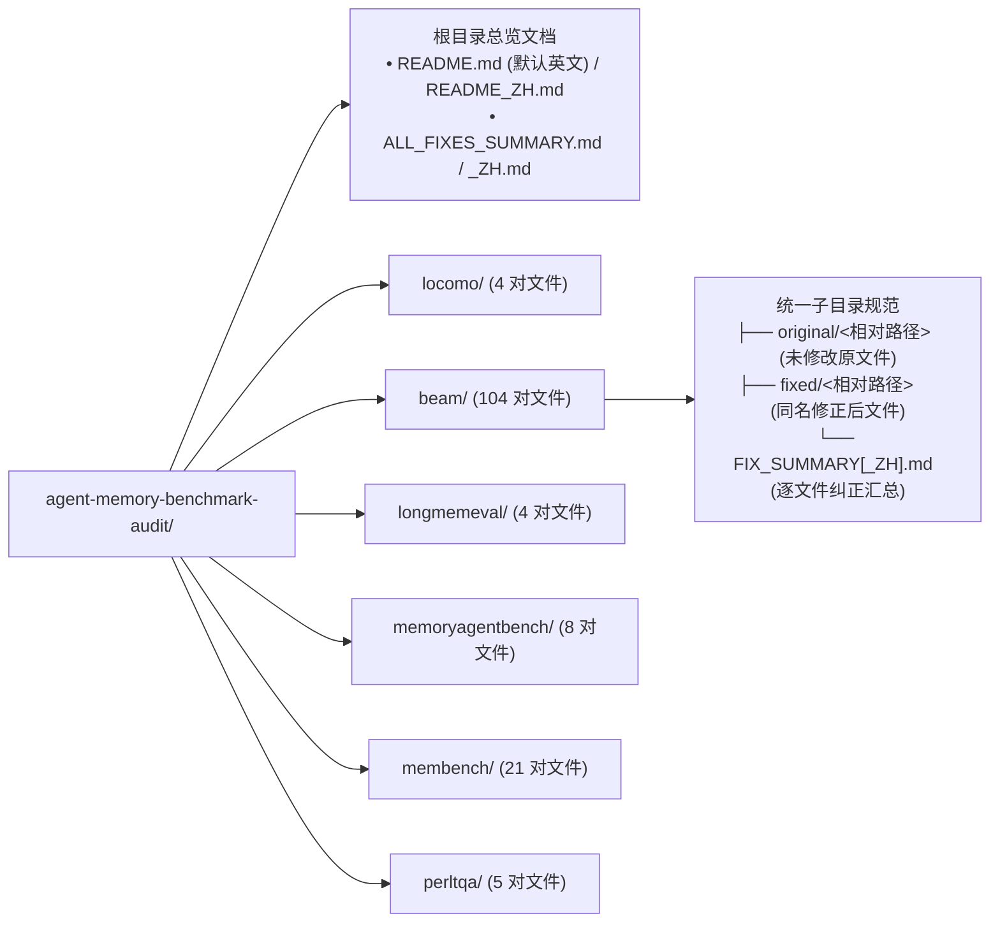
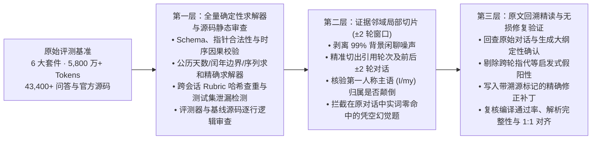
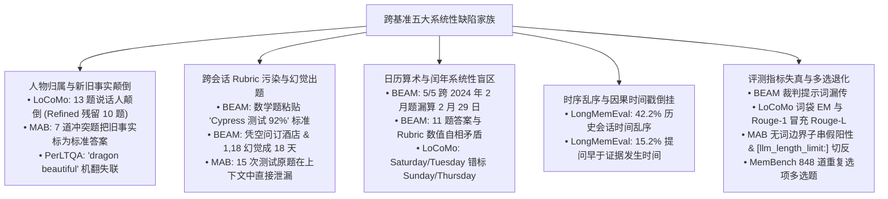

<div align="center">

# Agent Memory Benchmark 审计与修正合集

**面向 6 大主流智能体长期记忆基准的多轮结构校验、评测源码审查与深度语义 Ground-Truth 修正套件**

[](#四六大基准评测偏向与缺陷修复对比矩阵)
[](#二仓库架构与-11-同名镜像设计)
[](#一审计与修复全景仪表盘)
[](#三审计方法论三层混合审计漏斗3-layer-hybrid-funnel)
[](#六快速使用与差异验证指南)

[-1f2937?style=flat-square)](./README.md)
[-dc2626?style=flat-square)](./README_ZH.md)
[](./ALL_FIXES_SUMMARY_ZH.md)

[**全景总览**](#一审计与修复全景仪表盘) · [**目录架构**](#二仓库架构与-11-同名镜像设计) · [**审计方法论**](#三审计方法论三层混合审计漏斗3-layer-hybrid-funnel) · [**基准对比矩阵**](#四六大基准评测偏向与缺陷修复对比矩阵) · [**典型实锤案例**](#五代表性错误与修复前后对照案例) · [**快速上手**](#六快速使用与差异验证指南)

</div>

---

> [!IMPORTANT]
> **项目核心背景**：当前针对大模型智能体记忆系统（RAG、图记忆、情景/语义记忆、超长上下文 Agent）的评测结论受到大量**隐蔽评测噪声与系统性失真**的干扰——包括说话人张冠李戴、跨会话粘贴无关评分标准（Rubric）、2024 闰年 2 月 29 日系统性漏算、提问早于历史对话的因果倒挂，以及官方评测代码的逻辑漏洞。  
> 本仓库针对 **LoCoMo（含 LoCoMo_refined）**、**BEAM**、**LongMemEval**、**MemoryAgentBench**、**MemBench** 与 **PerLTQA** 提供**严格的 `original/` ↔ `fixed/` 1:1 镜像文件集**以及**中英双语逐文件错误与纠正台账**。

---

## 一、审计与修复全景仪表盘

| 评测基准 | 审计语料规模 | 1:1 镜像文件对 | 数据与标准答案（Ground-Truth）修复 | 评测器与基线代码修复 | 逐文件纠正台账 |
| :--- | :--- | :---: | :--- | :--- | :---: |
| **[LoCoMo & LoCoMo_refined](./locomo/)** | 20 组长对话 · 3,368 题（`1,986` + `1,382`） | `4` | **23 道**说话人张冠李戴（原版 `13` + 精炼版漏检残留 `10`）、精炼版 **1 道**反改错是否题、**3 道**星期错算/笔误、**28 处**轮次偏移/空指针、**29 处**损坏指针 | `evaluation.py` **4 项**指标计算 Bug + `llm_judge.py` 判分规则自相矛盾 | [中文](./locomo/FIX_SUMMARY_ZH.md) \| [EN](./locomo/FIX_SUMMARY.md) |
| **[BEAM](./beam/)** | 100 组超长对话（`100K`–`10M`，约 5,800 万 tokens）· 2,000 题 | `104` | 修正 **67 个会话文件（115 道题）**：**16 道**漏注入 `CR`/`KU` 题（+**1 道**对齐）、**65 道**损坏 `source_chat_ids` 证据指针、**2 道**跨会话 Cypress Rubric 污染、**4 道**幻觉题、**11 道**答案与 Rubric 冲突、**3 道**跳月与 **5 道**闰年 `Feb 29` 漏算、**8 道**排序计数 | 全部 **10 个**评测函数漏传 `<question>`、内层循环重复加载模型 **2,000 次**、列表别名跨题污染 | [中文](./beam/FIX_SUMMARY_ZH.md) \| [EN](./beam/FIX_SUMMARY.md) |
| **[LongMemEval](./longmemeval/)** | `Oracle`（500 题）+ `S_cleaned`（500 题，约 115K tok/题） | `4` | 两子集各 **62 题** `answer_session_ids` 混入伪证据会话（`32` 常规 + `30` `_abs`）、**13 处**重复 `session_id`、**245 题**历史会话乱序（`S` `211` + `Oracle` `34`）、**119 题**提问早于证据的因果倒挂（`S` `76` + `Oracle` `43`）、**64 题**整型答案 | 移除 `±1` 天/周/月误差宽容、收紧旧事实混同判分、修复 `'yes'` 子串假阳性与硬编码模型断言 | [中文](./longmemeval/FIX_SUMMARY_ZH.md) \| [EN](./longmemeval/FIX_SUMMARY.md) |
| **[MemoryAgentBench](./memoryagentbench/)** | 4 大能力子集 · 146 条长文本 · 3,671 题 | `8` | **7 道**冲突消解新旧答案写反、**2,238 处**模板拼写损坏、**1 条**完全重复长书样本、清理 **5,920 个**重复/测试集泄漏演示块（含 **15 次**测试原题泄漏）、**17 行**空 ID | 无词边界子串假阳性（`"no"` 命中 `"i do not know"`）、`encoded[llm_length_limit:]`（`127000`）反向切片、`longmem_qa_evaluate.py`、长窗口截断绕过 | [中文](./memoryagentbench/FIX_SUMMARY_ZH.md) \| [EN](./memoryagentbench/FIX_SUMMARY.md) |
| **[MemBench](./membench/)** | 19 个 JSON 子集（`FirstAgent` + `ThirdAgent`）· 26,637 题 | `21` | **47 道** `target_step_id` 证据指针修复（`43` 会话边界 `+1` 偏移 + `4` 空指针）、**3,127 处**模板拼接病句答案/选项（`"eight of week"`）、**848 道**重复选项多选题（**859 槽位**）、**7,460 个** `list` 选项、**65 条** `None` 消息 | 修复核心 Agent/Memory 类中 **2 处** Python 2 `raise "..."` 字符串异常崩溃 | [中文](./membench/FIX_SUMMARY_ZH.md) \| [EN](./membench/FIX_SUMMARY.md) |
| **[PerLTQA](./perltqa/)** | 141 名角色记忆库 · 8,593 道英文问答 | `5` | **25 名**角色字符串化字典 + **2 条**补回上游漏转缺失记忆（`8_2`、`25_0_2`，消除 **11 题**悬空引用）、`'dragon beautiful'` → `'Long Meili'`（**265 处**非档案引用 + **28 个**锚点键 + **8 条**问答文本）、**8,236 题**字符串化引用列表、重算 **11,613 个**英文字符锚点、剔除 **3 道**不可答题 | 修复 `dataset.py` 硬编码中文键、`modeling.py` `torch.no_grad()` 锁死训练梯度、`encoder_corpus.py` 漏括号崩溃 | [中文](./perltqa/FIX_SUMMARY_ZH.md) \| [EN](./perltqa/FIX_SUMMARY.md) |

---

## 二、仓库架构与 1:1 同名镜像设计

本仓库**不包含任何临时数据处理脚本**，根目录与 6 个数据集子文件夹严格遵循**同名相对路径 1:1 镜像规范**：



<details>
<summary><b>点击展开完整仓库文件树</b></summary>

```text
agent-memory-benchmark-audit/
├── README.md                                   # 默认英文主文档 (English README)
├── README_ZH.md                                # 简体中文主文档
├── ALL_FIXES_SUMMARY.md                        # 全量数据集纠正总表 (English)
├── ALL_FIXES_SUMMARY_ZH.md                     # 全量数据集纠正总表 (简体中文)
│
├── locomo/
│   ├── FIX_SUMMARY.md / FIX_SUMMARY_ZH.md
│   ├── original/                               # locomo10.json, locomo_refined.json, evaluation.py, llm_judge.py
│   └── fixed/                                  # 1:1 同名修正版数据与评测代码
│
├── beam/
│   ├── FIX_SUMMARY.md / FIX_SUMMARY_ZH.md
│   ├── original/                               # probing_questions/{100K,500K,1M,10M}/* (100个文件) + 4个 .py 源码
│   └── fixed/                                  # 全量 100 组修正后探测题目录（含 67 组缺陷修复）+ 4个 .py 源码
│
├── longmemeval/
│   ├── FIX_SUMMARY.md / FIX_SUMMARY_ZH.md
│   ├── original/                               # longmemeval_oracle.json, longmemeval_s_cleaned.json.gz, evaluate_qa.py, print_qa_metrics.py
│   └── fixed/                                  # 1:1 同名修正版数据与评测代码
│
├── memoryagentbench/
│   ├── FIX_SUMMARY.md / FIX_SUMMARY_ZH.md
│   ├── original/                               # 4个 .parquet 子集 + eval_other_utils.py, longmem_qa_evaluate.py, graph_rag.py, agent.py
│   └── fixed/                                  # 1:1 同名修正版数据与源码
│
├── membench/
│   ├── FIX_SUMMARY.md / FIX_SUMMARY_ZH.md
│   ├── original/                               # FirstAgent/*.json (11个), ThirdAgent/*.json (8个), MembenchAgent.py, CommonMemory.py
│   └── fixed/                                  # 1:1 同名修正版数据与框架源码
│
└── perltqa/
    ├── FIX_SUMMARY.md / FIX_SUMMARY_ZH.md
    ├── original/                               # perltmem_en_v2.json, perltqa_en_v2.json, dataset.py, modeling.py, encoder_corpus.py
    └── fixed/                                  # 1:1 同名修正版记忆库、问答集与加载/训练源码
```

</details>

---

## 三、审计方法论：三层混合审计漏斗（3-Layer Hybrid Funnel）

直接从头通读 5,800 万 tokens 的长对话不仅规模不可行，还会因 99% 无关闲聊稀释注意力而漏掉日期减法与主语颠倒细节；而纯结构脚本又无法识别内容张冠李戴。本项目采用**三层混合审计漏斗**实现高召回率与零误修：



---

## 四、六大基准评测偏向与缺陷修复对比矩阵



| 基准名称 | 核心评测偏向 | 结构与代码层关键缺陷修复 | 语义与标准答案层关键缺陷修复 |
| :--- | :--- | :--- | :--- |
| **LoCoMo & LoCoMo_refined** | 双人长周期社交闲聊事实抽取；原版词汇指标极度偏好极短词重叠而惩罚自然表述 | 词袋 `set` 无序 EM；停用词误删 `"and"`；`rougel_score` 返回 `rouge-1`；多跳单向 F1 不惩罚瞎猜；`llm_judge.py` 额外细节规则前后冲突 | 原版 **13 题**（`LoCoMo_refined` 漏检残留 **10 题**）把说话人 A 自述经历问成说话人 B；精炼版 **1 题**是否极性反改错；**3 题**星期错算/反引号笔误；**28 处**轮次指针偏移或空白 |
| **BEAM** | 100% 依赖基于 Rubric 的 LLM-Judge（评测时完全不读取 `answer` / `ideal_answer`！） | `unified_llm_judge_base_prompt` 漏传 `<question>`；`messages = saved_messages` 引用别名污染后续第 2–20 题；循环内重复加载模型 2,000 次 | **16 道**在 `chat.json` 中漏注入的矛盾/更新题（+**1 道**对齐）；**65 道**损坏/缺失 `source_chat_ids` 证据指针（`27 CR + 23 KU + 12 SUM + 2 PF + 1 EO`）；**2 道**粘贴 `"Cypress tests ... 92%"` Rubric；**3 道**幻觉题；**11 道**答案与 Rubric 冲突；**5 道**闰年 `Feb 29` 漏算与 **3 道**跳月错算 |
| **LongMemEval** | 多会话大海捞针式用户体验问答，原裁判规则过度宽容 | 裁判允许 `±1` 天/周/月算术误差、允许旧事实与新事实混答；`'yes' in response.lower()` 子串假阳性；硬编码 `gpt-4o-2024-08-06` 断言崩溃 | 两子集各 **62/500（12.4%）** `answer_session_ids` 混入 `has_answer: false` 伪证据会话；`s_cleaned` 中 **211/500（42.2%）**历史会话未按时间排序；**76/500（15.2%）** `question_date` 早于对话历史；**13 处**重复 `session_id` 碰撞 |
| **MemoryAgentBench** | 拼接多源异构数据集评估四类记忆能力，截断预算不一致 | `substring_exact_match_score` 缺词边界（`"no"` 命中 `"I do not know"`，`"1"` 命中 `"10"`）；`graph_rag.py` 误写 `encoded[llm_length_limit:]`（`127000`）丢弃正文；`agent.py` 截断绕过 | `Conflict_Resolution` **7 道题**误将已作废的旧事实标为 Gold；`Test_Time_Learning` 存在 **15 次**测试集原题泄漏及 **5,905 个**重复演示块；`Long_Range_Understanding` 含完全重复长书行 |
| **MemBench** | 双视角结构化合成轨迹上的四选一封闭式准确率 | `MembenchAgent.py` 与 `CommonMemory.py` 含 Python 2 `raise "..."` 语法崩溃；`7,460 个`列表型选项与 `65 条` `None` 消息 | **47 道** `target_step_id` 证据指针缺陷（`43` 处会话边界 `+1` 偏移 + `4` 处空指针）；**848 道**四选一题含重复选项；**3,127 处**模板病句（`"eight of week"`、`"seven of month"`、`"1 people"`） |
| **PerLTQA** | 由中文合成后机翻为英文的角色记忆库，官方仓库缺失生成式问答评测脚本 | `dataset.py` 硬编码中文键 `v["关系"]`；`modeling.py` 用 `with torch.no_grad():` 包裹训练前向损失；`encoder_corpus.py` 漏写 `is_available()` 括号 | 主角 `"龙美丽"` 机翻为 `'dragon beautiful'`（**265 处**非档案引用 + **28 个**锚点键 + **8 条**问答文本）；补回 **2 条**上游漏转记忆（`8_2`、`25_0_2` 修复 **11 题**悬空引用）与 **25 个**字符串化字典；重算 **11,613 个**英文字符级锚点；剔除 **3 道**不可答题 |

---

## 五、代表性错误与修复前后对照案例

<details open>
<summary><b>案例 1 — BEAM 跨会话 Rubric 复制粘贴污染与内部算术三方冲突</b></summary>

在 `beam/original/probing_questions/500K/8/probing_questions.json`（`contradiction_resolution[0]`）中，对话内容是纯数学圆锥曲线辅导，但唯一参与判分的 `rubric` 却粘贴了软件测试会话（`1M/2 CR[1]`）的评分标准：

| 字段 | `original/`（原版缺陷） | `fixed/`（修正后） |
| :--- | :--- | :--- |
| **问题** | `"Have I worked on ellipse and hyperbola problems before, or is this my first time encountering them?"` | *(保持不变)* |
| **`rubric[1]`** | ❌ `"LLM response should mention: you said you created Cypress tests for user login and personalized feed with a passing rate of 92%"` | ✅ `"LLM response should mention: you said you have never solved any ellipse or hyperbola problems before"` |
| **`rubric[2]`** | ❌ `"LLM response should mention: you mentioned you have never created any Cypress tests for those features."` | ✅ `"LLM response should mention: you mentioned completing several ellipse and hyperbola problems with a good score"` |

又如 `10M/5 multi_session_reasoning[0]`（问 2024 年 7 月与丈夫 Devin 讨论向量加法的总分钟数）：
* `original/`：`reasoning_steps` 写 `60 + 50 + 50 = 160 minutes`，`answer` 与 `rubric` 要求 **`350 minutes`**，而核查原对话（`id=74` 1小时 + `id=3276` 50分钟；`id=3277` 实为助手回复）真实总时长为 **`110 minutes`**。
* `fixed/`：将 `answer`、`reasoning_steps`、`source_chat_ids` 与 `rubric` 统一修正对齐为 **`110 minutes`**。

</details>

<details>
<summary><b>案例 2 — LoCoMo 与 LoCoMo_refined 漏检残留的说话人张冠李戴</b></summary>

`locomo10.json` 中的 13 道说话人颠倒题有 **10 道**原封不动留在了 `locomo_refined.json` 中：

* **对话原文证据（`Conv 4, D27:19`，发言人为 Tim）**：  
  `Tim: "Harry Potter is my favorite book. It's so immersive!"`
* **`original/locomo_refined.json` (`Conv 4 QA 142`)**：  
  ❌ `question`: `"What is John's favorite book series?"`, `answer`: `["Harry Potter"]`
* **`fixed/locomo_refined.json` (`Conv 4 QA 142`)**：  
  ✅ `question`: `"What is Tim's favorite book series?"`, `answer`: `["Harry Potter"]`

</details>

<details>
<summary><b>案例 3 — MemoryAgentBench 冲突答案写反与 GraphRAG 反向切片</b></summary>

* **`Conflict_Resolution`（`factconsolidation_sh_32k` Q8）**：
  * 上下文事实链：`707. Noel Pemberton Billing worked in the city of London.` → `1929. Noel Pemberton Billing worked in the city of Washington, D.C..`
  * 任务规则明确规定：序号更大的最新陈述覆盖旧陈述。
  * ❌ `original/`：`answers = ["London"]`（旧事实！） → ✅ `fixed/`：`answers = ["Washington, D.C."]`
* **`graph_rag.py`（第 552、604 行）**：
  ```diff
  - expanded_context = tokenzier.decode(encoded[llm_length_limit:])   # Bug: 丢弃了前 127K 正文 token，只保留超长溢出尾部！
  + expanded_context = tokenzier.decode(encoded[:llm_length_limit])   # Fixed: 正确保留前 127K token 上下文
  ```

</details>

<details>
<summary><b>案例 4 — PerLTQA 角色名机翻断链与训练梯度锁死</b></summary>

* **`perltqa_en_v2.json` vs. `perltmem_en_v2.json`**：主角 `"龙美丽"` 在记忆库中键名为 `'Long Meili'`，但问答集中全部 **265 处引用**被直译为 `'dragon beautiful'`，导致该角色检索命中率恒为 0。
* **`modeling.py` 与 `encoder_corpus.py`**：
  ```diff
  - with torch.no_grad():                        # Bug: 训练前向计算被关闭梯度，模型无法更新参数！
  + with torch.set_grad_enabled(self.training):  # Fixed: 训练模式下正常保留梯度图
  ```
  ```diff
  - device = 'cuda:0' if torch.cuda.is_available else 'cpu'    # Bug: 函数对象恒为 True，无 GPU 必崩！
  + device = 'cuda:0' if torch.cuda.is_available() else 'cpu'  # Fixed: 补全括号执行实际检测
  ```

</details>

---

## 六、快速使用与差异验证指南

### 1. 即插即用替换官方文件
每个子目录下的 `fixed/` 与 `original/` 具有完全一致的相对路径，可直接覆盖到各基准官方仓库对应位置：

```bash
# 1. 解压 LongMemEval-S Cleaned（为适配 GitHub 单文件 <100MB 限制采用无损 Gzip 存储）
gunzip -k longmemeval/fixed/longmemeval_s_cleaned.json.gz
# -> 生成标准 JSON: longmemeval/fixed/longmemeval_s_cleaned.json

# 2. 使用 diff 直接审查任意代码或数据文件的修改前后差异
diff -u locomo/original/evaluation.py locomo/fixed/evaluation.py
diff -u beam/original/probing_questions/500K/8/probing_questions.json \
        beam/fixed/probing_questions/500K/8/probing_questions.json
```

### 2. Python 读取修复后的 Parquet 子集（以 MemoryAgentBench 为例）
```python
import pyarrow.parquet as pq

cr_fixed = pq.read_table("memoryagentbench/fixed/Conflict_Resolution-00000-of-00001.parquet")
ttl_fixed = pq.read_table("memoryagentbench/fixed/Test_Time_Learning-00000-of-00001.parquet")
print(f"Conflict Resolution rows: {cr_fixed.num_rows}, Test-Time Learning rows: {ttl_fixed.num_rows}")
```

---

## 七、版权声明与致谢

各子目录 `original/` 下收录的原始数据集与评测源码版权归各原基准作者所有，遵循各上游仓库原有开源协议（**LoCoMo**、**LoCoMo_refined**、**BEAM**、**LongMemEval**、**MemoryAgentBench**、**MemBench**、**PerLTQA**）。本仓库提供的审计台账、数据清洗与评测修复补丁旨在推动更公平、可复现的智能体长期记忆研究。
